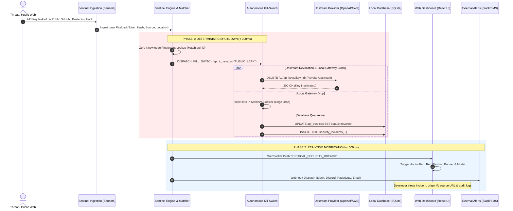
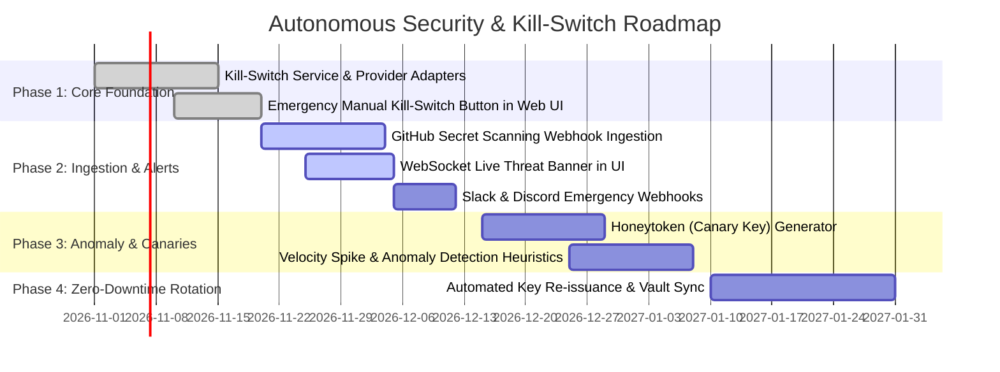

# Future Scope: Automated API Leak Detection, Real-Time Alerting & Autonomous Kill-Switch Architecture

> **Document Type:** System Architecture Blueprint & Future Scope Specification  
> **Target Project:** API Token Tracking & Subscription Management System  
> **Status:** Proposed / Architectural Design  
> **Version:** 1.0.0  

---

## 1. Executive Summary & Problem Statement

In modern cloud and AI-driven software development, API keys (e.g., OpenAI, Anthropic, AWS, Stripe, GitHub, Database credentials) represent direct financial, operational, and data-security liabilities. A leaked API key can lead to:

1. **Catastrophic Financial Runaway:** An exposed LLM token (OpenAI/Anthropic) can accumulate thousands of dollars (₹ lakhs) in unauthorized inference requests within minutes via automated bot scraping.
2. **Infrastructure & Data Exfiltration:** Breached cloud or database credentials expose customer PII, intellectual property, and proprietary systems.
3. **Compliance & Legal Violations:** Non-compliance with SOC 2, ISO 27001, GDPR, and PCI-DSS, triggering severe audits and penalties.

### The Objective
To evolve the **API Token Tracking & Subscription Management System** from a passive tracking and logging dashboard into an **active, autonomous security control plane**. 

When an API token is leaked in production, committed to a public repository, exposed in a client-side bundle, or compromised via a server hack:
- **"Show Us" (Immediate Visibility):** Instantly alert developers and security administrators across the web dashboard (real-time WebSocket banner, push notification, audio alarm) and external communication channels (Slack, Discord, PagerDuty, Email, SMS).
- **"Shutdown the API" (Deterministic Kill-Switch):** Autonomously revoke, disable, or invalidate the compromised key at both the upstream provider (OpenAI, AWS, Anthropic, etc.) and the local gateway within milliseconds, stopping unauthorized consumption immediately.

---

## 2. Threat Vector Taxonomy

The autonomous security system monitors and mitigates four distinct leak vectors:

```
                                 ┌────────────────────────────────────────────────────────┐
                                 │                THREAT VECTORS MONITORED                │
                                 └───────────────────────────┬────────────────────────────┘
                                                             │
         ┌───────────────────────────┬───────────────────────┴───────────────────────┬───────────────────────────┐
         ▼                           ▼                                               ▼                           ▼
┌───────────────────┐       ┌───────────────────┐                           ┌───────────────────┐       ┌───────────────────┐
│  Vector 1: Git &  │       │Vector 2: Frontend │                           │ Vector 3: Server  │       │ Vector 4: Threat  │
│    Public Leaks   │       │   Bundle Leaks    │                           │  Breach / Abuse   │       │   Intelligence    │
├───────────────────┤       ├───────────────────┤                           ├───────────────────┤       ├───────────────────┤
│ • Public GitHub   │       │ • Leaked into SPA │                           │ • SSRF / RCE hack │       │ • Pastebin dumps  │
│   pushes          │       │   client builds   │                           │ • Velocity spikes │       │ • Dark web feeds  │
│ • Docker images   │       │ • Exposed sourcemap│                          │ • Geolocation jump│       │ • TOR exit nodes  │
│ • Unmasked logs   │       │ • DevTools network│                           │ • Canary tripped  │       │ • Public gist/raw │
└───────────────────┘       └───────────────────┘                           └───────────────────┘       └───────────────────┘
```

1. **Vector 1: Public Code & Artifact Leaks:** Accidental commits to public GitHub/GitLab repositories, public Docker Hub images, CI/CD public artifacts, or unmasked logs.
2. **Vector 2: Production Client-Side Exposure:** API keys inadvertently baked into Vite/React frontend client bundles (`VITE_*` environment variables) or exposed in production network headers.
3. **Vector 3: Infrastructure Compromise & Runtime Abuse:** A compromised production server (via SSRF/RCE) leaking memory dumps, or anomalous traffic patterns indicating credential theft (e.g., sudden 500x request velocity, unknown foreign IP address, headless scrapers).
4. **Vector 4: Threat Intelligence & Dark Web Feeds:** Scraped pastebins, public hacker paste sites, Discord/Telegram breach channels, and Shodan/Censys indices.

---

## 3. High-Level System Architecture

The Sentinel Architecture consists of five loosely-coupled, high-throughput components:

```
┌─────────────────────────────────────────────────────────────────────────────────────────────────┐
│                                   1. SENSORS & INGESTION LAYER                                  │
│  GitHub Secret Scanning  │  CI/CD Static Scanners  │  Proxy Telemetry  │  Honeytoken Canaries   │
└───────────────────────────────────────────────┬─────────────────────────────────────────────────┘
                                                │ Raw Detection Events / Telemetry
                                                ▼
┌─────────────────────────────────────────────────────────────────────────────────────────────────┐
│                                  2. SENTINEL PROCESSING ENGINE                                  │
│       Event Deduplication  │  Zero-Knowledge Fingerprint Matcher  │  Anomaly Heuristics        │
└───────────────────────┬─────────────────────────────────────────────────┬───────────────────────┘
                        │                                                 │
      [Trigger Instant Kill-Switch]                             [Publish Incident Alert]
                        ▼                                                 ▼
┌───────────────────────────────────────────────┐ ┌───────────────────────────────────────────────┐
│     3. AUTONOMOUS KILL-SWITCH ORCHESTRATOR    │ │     4. REAL-TIME ALERTING & SOC DASHBOARD     │
│ • Upstream Provider API Revocation (OpenAI etc)│ │ • WebSocket / SSE Live Alert Banner (Web UI) │
│ • Edge & Reverse-Proxy In-Memory Blocklist    │ │ • Sound / Modal Alarm for Critical Incidents  │
│ • Database State Quarantine (status='revoked')│ │ • Slack, Discord, PagerDuty, SMS Dispatch     │
│ • Downstream Microservice Eviction Broadcast  │ │ • Detailed Forensics Log & Post-Mortem Card   │
└───────────────────────┬───────────────────────┘ └───────────────────────────────────────────────┘
                        │
                        ▼
┌─────────────────────────────────────────────────────────────────────────────────────────────────┐
│                              5. SECRETS VAULT & FALLBACK ROTATION                               │
│  Auto-generate new replacement key → Store in Vault/DB → Hot-reload services without downtime   │
└─────────────────────────────────────────────────────────────────────────────────────────────────┘
```

---

## 4. End-to-End Sequence Diagram: Leak to Shutdown

The following sequence showcases what happens from the millisecond an API key is detected in the wild to its complete shutdown and user notification:



---

## 5. Detailed Component Specifications

### 5.1 Zero-Knowledge Token Fingerprinting (Security by Design)

To protect existing tokens, **the detection engine never compares plaintext keys in unencrypted memory or logs**.

- **Fingerprint Generation:** When an API key is registered in `api_services`, the system computes:
  - `prefix`: First 7 characters (e.g., `sk-proj-4A...`) for high-speed indexing.
  - `suffix`: Last 4 characters (e.g., `...9fX2`).
  - `token_hash`: SHA-256 HMAC of the normalized key with an application-level secret salt.
- **Match Mechanism:** When an external scanner finds a potential token, it extracts the prefix/suffix and computes the HMAC. If both match an active key in the local database, an incident is instantly declared.

### 5.2 Multi-Tier Ingestion & Sensor Layer

#### 1. GitHub & Cloud Secret Scanning Integration
- **GitHub Secret Scanning Partner Webhook:** Register the tracker system as a verified receiver for GitHub Secret Scanning. When an API key matching the system's pattern is committed to any public repository on GitHub, GitHub dispatches an automated HTTP POST webhook containing the commit URL, repository, and token fingerprint.
- **Pre-Commit Git Hooks & CI/CD Linter:** A lightweight CLI plugin (`npx api-track-guard`) embedded in developer pre-commit hooks (`husky`) and GitHub Actions to abort builds if tracked credentials are typed in code.

#### 2. Runtime Anomaly & Behavioral Breach Detection
The system tracks real-time usage telemetry from `apps/server/src/controllers/usage.controller.ts`:
- **Velocity Spike Detection:** If token consumption per minute surges by $> 400\%$ compared to the 7-day rolling baseline, the key is flagged as compromised.
- **Geographic Jump (Impossible Travel):** If requests originate from Mumbai and 2 minutes later from an IP located in Frankfurt, an alert is raised.
- **Untrusted User-Agent / Tooling:** A key configured for a `Node.js` server backend that suddenly receives requests from `curl/7.88.1`, `python-requests`, or known exploit scanners (`sqlmap`, `nuclei`).

#### 3. Honeytokens (Canary Tokens)
- Developers can deploy "Bait" or "Canary" API keys that are never used in valid production flows.
- If a Canary token receives even a single incoming request, it guarantees the server environment or codebase has been breached. The system triggers an instant lockdown across all active sibling API keys.

---

### 5.3 Autonomous Kill-Switch Engine ("Shutdown the API")

The Kill-Switch operates on four defensive rings to guarantee total revocation in under 500 milliseconds:

```
[RING 1: In-Memory Edge Drop] ───► Instant (0ms - 5ms)
       │ Drop all in-flight and incoming traffic at local proxy
       ▼
[RING 2: Upstream Provider Revocation] ───► Fast (50ms - 250ms)
       │ Call OpenAI / AWS / Anthropic Admin API to delete the key
       ▼
[RING 3: Database & State Quarantine] ───► Local (10ms - 30ms)
       │ Set api_services.status = 'revoked', log incident audit
       ▼
[RING 4: Microservice Eviction Broadcast] ───► Distributed (< 100ms)
       │ SSE/WebSocket broadcast to internal services to dump cached memory
```

#### Provider Revocation Adapters Matrix:
| Provider | Revocation Mechanism | Fallback / Behavior |
|---|---|---|
| **OpenAI** | `DELETE /v1/organization/admin_api_keys/{key_id}` | Invalidates key globally in < 2 seconds |
| **Anthropic** | `POST /v1/organizations/keys/{id}/revoke` | Revokes Claude inference access immediately |
| **AWS IAM / Bedrock** | `iam.UpdateAccessKey(Status='Inactive')` | Deactivates access key ID instantly |
| **GitHub Tokens** | `DELETE /applications/{client_id}/grant` | Revokes OAuth / Personal Access Token |
| **Stripe** | `POST /v1/api_keys/{key_id}/expire` | Expires restricted key immediately |
| **Generic / Custom APIs** | Webhook Dispatch to User's Infrastructure | Hits user's internal `/internal/revoke-api` webhook |

---

### 5.4 Real-Time Alerting & SOC Incident Command ("Show Us")

Visibility is divided into **Immediate In-App Takeover** and **External Emergency Dispatches**.

#### 1. In-App Web Client Experience (`apps/web`)
- **WebSocket Broadcast (`/ws/security-stream`):** Pushes high-priority telemetry straight to connected browser tabs.
- **Threat Banner & Critical Audio Beacon:**
  - A persistent, pulsating crimson banner across the top of all routes:
    ```
    🚨 CRITICAL ALERT: OpenAI GPT-4o API Key leaked on GitHub (Commit #8b2f91) 
    Status: AUTONOMOUSLY REVOKED (0.24s ago) • Unauthorized Cost Stopped: ₹0.00
    ```
  - An optional synthesized sound cue (configurable in preferences).
- **Incident Modal & Forensics Panel:**
  - Displays leak timestamp, origin URL (e.g. `https://github.com/org/repo/commit/...`), offending IP address, detection vector, and immediate verification of the revocation status.
  - One-click button: **[Acknowledge Incident]**, **[Rotate & Issue New Key]**, or **[Download Post-Mortem Report]**.

#### 2. External Alert Channels
- **Slack & Discord Webhooks:** Sends interactive rich message cards with action buttons:
  - `[✅ Confirm Revocation]` `[🔄 Deploy Replacement Key]` `[🔍 View Audit Log]`
- **PagerDuty & OpsGenie:** Triggers P1 Critical Incident escalation for on-call engineers.
- **SMS & Email Notification:** Dispatched via Twilio and Resend with high-priority headers.

---

## 6. Proposed Database Schema Additions

To support this architecture within the current SQLite database (`apps/server/data/tracker.db`), the following tables are introduced:

```sql
-- 1. Security Incidents Table
CREATE TABLE IF NOT EXISTS security_incidents (
    id TEXT PRIMARY KEY,                       -- UUID v4
    user_id TEXT NOT NULL,                     -- Foreign Key to profiles.id
    api_id TEXT NOT NULL,                      -- Foreign Key to api_services.id
    severity TEXT NOT NULL CHECK(severity IN ('critical', 'high', 'medium', 'low')),
    detection_vector TEXT NOT NULL CHECK(detection_vector IN ('git_leak', 'client_bundle', 'runtime_anomaly', 'honeytoken_tripped', 'threat_intel')),
    source_reference TEXT,                     -- URL to GitHub commit, IP address, or filename
    status TEXT NOT NULL CHECK(status IN ('active', 'mitigated', 'acknowledged', 'false_positive')),
    killswitch_executed BOOLEAN DEFAULT 1,     -- 1 if autonomous killswitch executed
    killswitch_latency_ms INTEGER,             -- Time taken to shutdown (e.g. 180ms)
    estimated_damage_saved REAL DEFAULT 0.0,   -- Estimated financial loss prevented (in INR)
    metadata_json TEXT,                        -- Raw incident payload
    created_at DATETIME DEFAULT CURRENT_TIMESTAMP,
    resolved_at DATETIME,
    FOREIGN KEY (api_id) REFERENCES api_services(id) ON DELETE CASCADE,
    FOREIGN KEY (user_id) REFERENCES profiles(id) ON DELETE CASCADE
);

-- 2. Canary (Honeytoken) Registry
CREATE TABLE IF NOT EXISTS canary_tokens (
    id TEXT PRIMARY KEY,
    user_id TEXT NOT NULL,
    provider TEXT NOT NULL,                    -- e.g. 'OpenAI-Canary'
    canary_token_hash TEXT NOT NULL UNIQUE,    -- SHA-256 hash of decoy token
    token_prefix TEXT NOT NULL,                -- e.g. 'sk-canary-...'
    deployed_environment TEXT NOT NULL,        -- 'github_repo', 'docker_container', 'env_file'
    is_tripped BOOLEAN DEFAULT 0,
    tripped_at DATETIME,
    tripped_ip TEXT,
    tripped_user_agent TEXT,
    created_at DATETIME DEFAULT CURRENT_TIMESTAMP,
    FOREIGN KEY (user_id) REFERENCES profiles(id) ON DELETE CASCADE
);

-- 3. Provider Killswitch Configurations
CREATE TABLE IF NOT EXISTS provider_killswitch_configs (
    id TEXT PRIMARY KEY,
    user_id TEXT NOT NULL,
    provider TEXT NOT NULL,                    -- 'OpenAI', 'AWS', 'Anthropic', etc.
    admin_api_key_encrypted TEXT,              -- Master management token with revocation permissions
    auto_revoke_enabled BOOLEAN DEFAULT 1,     -- Auto-execute killswitch on detection
    notify_slack BOOLEAN DEFAULT 1,
    notify_pagerduty BOOLEAN DEFAULT 0,
    slack_webhook_url TEXT,
    created_at DATETIME DEFAULT CURRENT_TIMESTAMP,
    FOREIGN KEY (user_id) REFERENCES profiles(id) ON DELETE CASCADE
);
```

---

## 7. REST & WebSocket API Specification

### 7.1 Webhook Ingestion Endpoint
- **Route:** `POST /api/v1/security/ingest-leak`
- **Access:** HMAC Signed (GitHub Webhook Secret / Secret Scanner Token)
- **Payload:**
  ```json
  {
    "event_type": "SECRET_DETECTED",
    "detector": "github_secret_scanning",
    "token_prefix": "sk-proj-4A12",
    "token_hash": "e3b0c44298fc1c149afbf4c8996fb92427ae41e4649b934ca495991b7852b855",
    "source_url": "https://github.com/company/repo/commit/4c5d8a9e",
    "timestamp": "2026-10-20T23:14:50Z"
  }
  ```
- **Response:**
  ```json
  {
    "status": "INCIDENT_DECLARED",
    "api_id": "9b1deb4d-3b7d-4bad-9bdd-2b0d7b3dcb6d",
    "killswitch_status": "REVOKED_SUCCESSFULLY",
    "latency_ms": 142
  }
  ```

### 7.2 Manual Emergency Kill-Switch Endpoint
- **Route:** `POST /api/v1/security/killswitch/:api_id`
- **Access:** Authenticated (Bearer JWT with Admin or Owner role)
- **Description:** Allows a developer to click "Emergency Shutdown" directly from the UI table to instantly revoke a key upstream and block downstream traffic.

### 7.3 Real-Time WebSocket Streaming
- **Route:** `ws://localhost:5000/ws/security-stream?token={JWT}`
- **Emitted Event:**
  ```json
  {
    "type": "SECURITY_INCIDENT_CRITICAL",
    "incident_id": "sec_01J9X83",
    "api_name": "Production OpenAI GPT-4o",
    "provider": "OpenAI",
    "vector": "git_leak",
    "location": "github.com/my-org/backend",
    "action_taken": "SHUTDOWN_COMPLETED",
    "timestamp": "2026-10-20T23:15:02Z"
  }
  ```

---

## 8. Phased Implementation Roadmap



### Phase 1: Core Kill-Switch Foundation (Immediate Next Step)
1. Implement `KillSwitchService` in `apps/server/src/services/killswitch.service.ts` with direct support for OpenAI, Anthropic, and AWS credential deactivation.
2. Add an **"Emergency Revoke"** button to the API Services list and API details view in `apps/web`.
3. Update `api_services.status` schema and state handling to support `'revoked_compromised'`.

### Phase 2: Webhook Ingestion & In-App Threat Notification
1. Implement `/api/v1/security/ingest-leak` route with signature verification.
2. Integrate WebSocket server in Express (`ws` library) and subscribe the React frontend using a global `SecurityBanner` component.
3. Configure multi-channel notification dispatchers for Slack and Discord.

### Phase 3: Honeytokens & Runtime Anomaly Heuristics
1. Build a Canary Token generator where users can deploy trap keys into their repositories.
2. Connect real-time analytics stream to calculate standard deviation and flag velocity anomalies ($> 400\%$ normal burn).

### Phase 4: Self-Healing & Automated Rotation
1. Automatically provision a replacement API key from the provider upon killing the compromised key.
2. Push updated secret to GitHub Actions / Vercel Environment / AWS Secrets Manager via their respective APIs.

---

## 9. Conclusion

By implementing this architecture, the **API Token Tracking & Subscription Management System** transitions from a passive administrative tool to an **indispensable defensive guardian**. Leaked credentials—whether caused by a junior developer pushing `.env` to GitHub or an attacker hacking a cloud server—will be detected in real time, announced through instant visual alarms, and neutralized before financial or operational catastrophe strikes.
